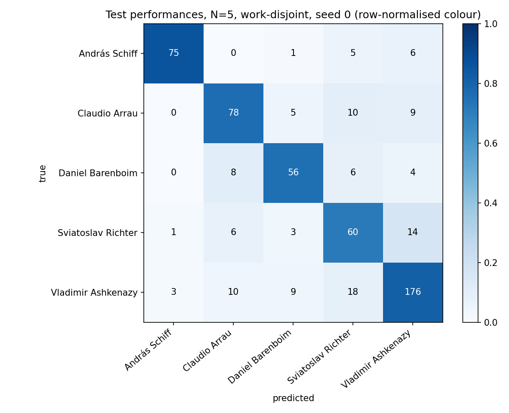
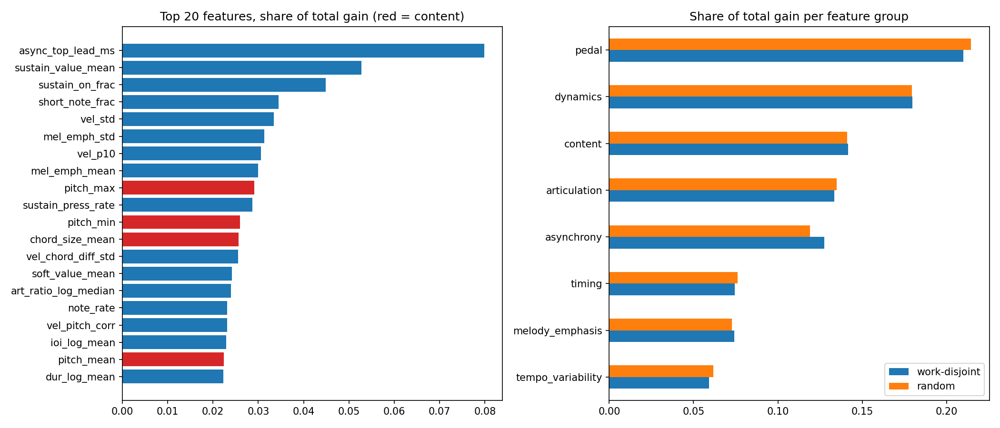

# Who Is Playing? Pianist identification from expressive piano MIDI

[](https://colab.research.google.com/github/caganaksoyy/CS464_group13/blob/main/notebooks/01_xgboost_baseline.ipynb) notebook 01 (XGBoost demo)

Given a segment of a classical piano performance in MIDI format, predict which pianist
played it. Many pianists in the dataset recorded the same pieces, so the notes alone
cannot reveal the answer; models must learn expressive style (timing, dynamics,
articulation, pedalling). Test sets contain only compositions never seen in training.

Data: ATEPP v1.2 (Zhang et al., ISMIR 2022), performance MIDI transcribed from audio.

**Status:** Milestone 2 done: XGBoost baseline (demo). Next: content ablation + era check, then LogReg/SVM and PyTorch models (CNN/LSTM/Transformer).

## Repository layout

```
configs/            YAML configs (data.yaml; tiny.yaml = CPU smoke-test overrides)
src/pianist_id/     the library the notebooks import
  paths.py          Drive vs local storage locations
  colab.py          session setup used by every notebook
  data/             archive extraction, metadata, MIDI parsing, splits, segments
  features/         handcrafted segment features, grouped by musical aspect
  models/           XGBoost baseline
  utils/            config loading, seeding, run logging
notebooks/          what you run on Colab (orchestration, plots, commentary)
tests/              pytest unit tests + notebook smoke runs on synthetic data
docs/               DATA_NOTES, DECISIONS, COLAB instructions
report/             report material (later milestones)
```

## Running on Colab

See [docs/COLAB.md](docs/COLAB.md) for the one-time setup (optional GitHub token as a
Colab secret, Drive layout; the ATEPP zip is downloaded automatically if it is not on
Drive). Then open a notebook, e.g. with the badge above, and *Run all*.

| Notebook | Purpose | Runtime |
|---|---|---|
| `00_setup_and_data_audit.ipynb` | schema, quality tags, duplicates, per-pianist stats, MIDI properties | CPU, ~2–5 min |
| `01_xgboost_baseline.ipynb` | segment features, XGBoost, work-disjoint vs random split, confusion matrix, feature-group importance | CPU, ~15–20 min |

## Local development (CPU)

```bash
py -3.12 -m venv .venv
.venv\Scripts\python -m pip install -r requirements-dev.txt -e .
.venv\Scripts\python -m pytest -q
```

The tests build a synthetic ATEPP-like archive (3 fake pianists with deliberately
different styles) and run every notebook top to bottom in tiny mode
(`pytest -m "not slow"` skips the notebook runs).

## Results

XGBoost on handcrafted features, performance-level, mean ± std over seeds 0/1/2.
Source run: Colab, CPU, Python 3.13, xgboost 3.4.1, commit `6ea1b34`, run folder `results/xgb_baseline/20261123-164429`.

| N | Split | Perf. acc | Macro-F1 | Seg. acc | Chance |
|---|---|---|---|---|---|
| 5 | work-disjoint | 0.755 ± 0.032 | 0.761 ± 0.018 | 0.568 ± 0.017 | 0.20 |
| 5 | random | 0.847 ± 0.010 | 0.845 ± 0.010 | 0.672 ± 0.010 | 0.20 |
| 10 | work-disjoint | 0.649 ± 0.022 | 0.638 ± 0.025 | 0.434 ± 0.021 | 0.10 |
| 10 | random | 0.789 ± 0.013 | 0.769 ± 0.019 | 0.544 ± 0.014 | 0.10 |

The Colab results match the local run (difference ≤ 0.002 in mean performance accuracy and macro-F1).

Performance accuracy aggregates the 20 s segments of each test performance.
The work-disjoint split is the real task.
The random split lets the same piece and re-released recordings appear in both train and test (D-016).

### Key findings

- **Leakage effect:** the random - work-disjoint gap is 0.092 for N=5 and 0.140 for N=10.
  The model gains points by recognising the same works and re-released recordings; comparing against the work-disjoint split measures this.
- **Segment voting:** aggregating over a recording gains ~19 points over segment accuracy (N=5 work-disjoint: 0.568 → 0.755).
- **Early stopping:** for N=5 the model stops at ~850 trees on work-disjoint and ~1490 on random.
  The signal that generalises to unseen works runs out earlier.
- **Per-pianist F1 (N=5, work-disjoint):** Schiff 0.890, Ashkenazy 0.772, Arrau 0.759, Barenboim 0.747, Richter 0.635.
- **Feature group importance (gain share, N=5 work-disjoint):** pedal 0.210, dynamics 0.180, content 0.142, articulation 0.134, asynchrony 0.127, timing 0.074, melody_emphasis 0.074, tempo_variability 0.059.





### Caveats / open questions

These are hypotheses, not established results.

- Pedal is the most important group, but the mean of `sustain_on_frac` is 0.90.
  This suggests that the pedal information may come partly from the transcription model and the recording conditions.
- Richter's low F1 may be related to the wide time span of the recordings (1961-2021, 87 albums), and Schiff's high F1 to more homogeneous recordings (after 1981).
  The model may be partly learning the recording era or conditions.
- The content group's share (14%) suggests that the model may partly look at what is played.
- Planned checks: an ablation without the content group, and an accuracy table by `album_date` decade.

## Citation

Zhang, H., Tang, J., Rafee, S. R. M., Dixon, S., & Fazekas, G. (2022). ATEPP: A Dataset
of Automatically Transcribed Expressive Piano Performance. *Proceedings of the 23rd
International Society for Music Information Retrieval Conference (ISMIR).*
Dataset license: CC BY 4.0.
